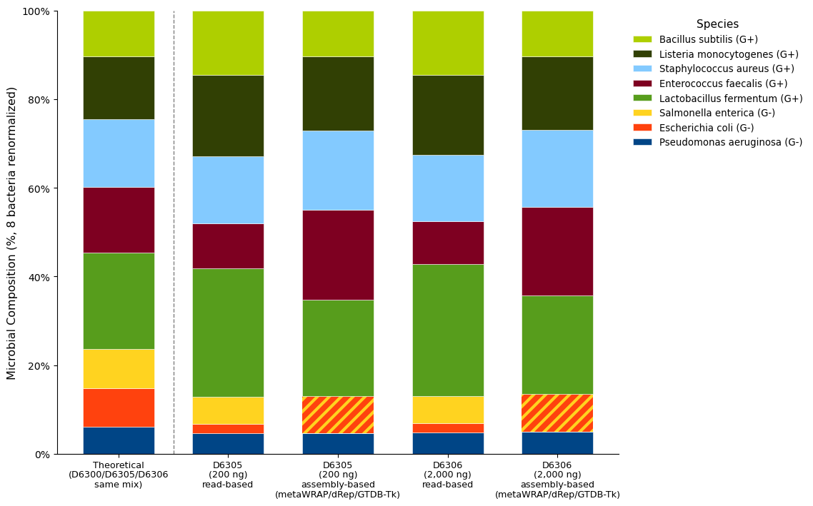
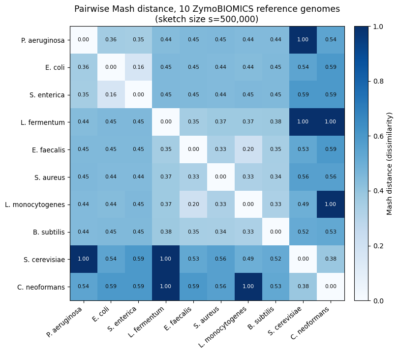

# Vignette: ZymoBIOMICS Microbial Community DNA Standard (D6305/D6306)

!!! note "Status"
    Every number and figure on this page comes from a real, completed metamorph `--workflow combined` run against 2 samples (`in3634_1` = D6305, `in3634_2` = D6306). **This page is deliberately standalone and does not compare any number to the [D6300 vignette](zymo-vignette.md)'s results** — different product format, different sample count, different sequencing run, no statistical pooling between the two pages. [Section 6](#6-caveats-and-how-this-differs-from-the-d6300-vignette) spells out exactly how and why.

## 1. About

[ZymoBIOMICS® Microbial Community **DNA** Standard](https://www.zymoresearch.com/products/zymobiomics-microbial-community-standard) (catalog **D6305**, 200 ng; **D6306**, 2,000 ng) ships the same defined 8-bacteria/2-yeast community as the [D6300 Microbial Community Standard](zymo-vignette.md) already covered on this site — but as **pre-extracted, purified genomic DNA**, not live/fixed cells. The vendor's own datasheet ([DS1706](https://files.zymoresearch.com/datasheets/ds1706_zymobiomics_microbial_community_standards_data_sheet.pdf)) covers both products: page 1 is D6300 (the cellular standard, 10 preps); page 2 is the DNA standard, sold at two input masses, D6305 (200 ng) and D6306 (2,000 ng) — **D6305 and D6306 are the same product at two masses, not two different compositions.** Its defined target composition is the same evenly-balanced mix as D6300's Table 1 (12% genomic DNA per bacterium, 2% per yeast) — confirmed directly, since the public datasheet's own DNA-standard page gives no per-species numeric table, only an unlabeled composition chart with the same 10-organism legend.

Because no extraction step happens on the user's end at all — the DNA arrives already purified — this standard isolates everything **downstream** of extraction: library preparation, sequencing, and classification bias, with extraction-method bias specifically removed as a variable. That is a different, narrower question than the D6300 page asks (which includes extraction bias), which is the main reason this page keeps its own analysis rather than folding into the existing one.

## 2. Vendor ground truth

Same 10 organisms, same defined mix as [the D6300 page's Table 1](zymo-vignette.md#2-vendor-ground-truth) — reused here unchanged, renormalized across the 8 target bacteria to the same **Genome Copy %** basis (the correct target for shotgun-sequencing-derived abundance, per that page's Section 2 note; genome sizes are for the same strains either way):

| Species | Genome Copy % (target, renormalized across 8 bacteria) |
| --- | ---: |
| *Lactobacillus fermentum* | 21.84 |
| *Staphylococcus aureus* | 15.37 |
| *Enterococcus faecalis* | 14.76 |
| *Listeria monocytogenes* | 14.05 |
| *Bacillus subtilis* | 10.41 |
| *Salmonella enterica* | 8.80 |
| *Escherichia coli* | 8.59 |
| *Pseudomonas aeruginosa* | 6.17 |

## 3. Data used in this run

| | `in3634_1` | `in3634_2` |
| --- | --- | --- |
| Product | D6305 | D6306 |
| DNA input mass | 200 ng | 2,000 ng |
| Raw read pairs | 5,356,541 | 5,928,215 |
| Sequencer | MiniSeq (run date 2023-01-23, per the submitter's rawdata-links manifest) | same |
| `--host-genome` used | No | No |

Standard material (D6305/D6306) was obtained directly from Zymo as the distributor; sequencing itself was performed via a third-party core facility, per the submitted rawdata-links manifest. This run used metamorph's `combined` workflow with **no** `--host-genome` yeast references injected — unlike the D6300 page, any yeast signal here was never screened out before classification, so both methods below can and do detect yeast reads directly.

Per-sample QC, from metamorph's own `qc_summary.tsv` (see the D6300 page's [Section 4.2](zymo-vignette.md#42-dehosting-how-much-was-screened-out-per-replicate) for the dehosting methodology it reuses):

| Metric | `in3634_1` (D6305) | `in3634_2` (D6306) |
| --- | ---: | ---: |
| Post-trim read pairs | 5,348,510 (99.85%) | 5,919,733 (99.86%) |
| Post-hg38-dehost read pairs | 5,343,788 (99.91% of post-trim) | 5,914,209 (99.91% of post-trim) |
| hg38 host alignment | 0.0883% | 0.0933% |
| Classifier input fragments | 5,343,788 | 5,914,209 |
| Classified (Centrifuger) | 96.02% | 96.18% |
| — bacterial | 92.44% | 92.60% |
| — eukaryotic (yeast + noise) | 2.30% | 2.31% |
| Unclassified | 3.97% | 3.81% |
| QC flags raised | none | none |

Both samples are roughly a third of the per-replicate depth of the D6300 page's 7 ENA replicates (14–19M read pairs there vs. ~5.3–5.9M here) — one more reason this page's numbers aren't pooled with that page's.

## 4. Methodology: two independent estimates, same generic rules as the D6300 page

This page reuses the **same two generic, mechanical naming rules** established on the D6300 page ([Section 5](zymo-vignette.md#5-two-independent-composition-estimates-vs-vendor-target)) — GTDB placeholder-suffix collapse, and current-GTDB-name mapping for *B. subtilis*/*spizizenii* and *L. fermentum*/*Limosilactobacillus* — applied identically here, no new rules invented for this data.

- **Read-based**: Centrifuger's per-sample species-level abundance (`centrifuger_dna/<sample>_centrifuger_quantification_report.tsv`), same as the D6300 page's read-based method.
- **Assembly-based**: this run's **own** `--workflow combined` output, built entirely from metaWRAP — `metawrap_binning`/`metawrap_bin_refine` (assembly, binning, bin refinement), `metawrap_bin_refine/dRep/dereplicated_genomes/` (the dereplicated genome set), `metawrap_kmer/GTDBTK_classify_wf/gtdbtk.bac120.summary.tsv` (genome identity), and `mags/<sample>/DNA/<sample>.refstats` (each sample's reads mapped back against that set) — same coverage-normalization logic as the D6300 page's assembly-based method (recruited bases ÷ genome size). Two bins metaWRAP's own QC rejected were hand-rescued — see Section 5.1 for exactly why, and why one is reported as its own species while the other is reported as a *combined, unseparated* pair rather than either individual species.

!!! note "The assembly-based estimate covers all 8 bacteria, but 2 of them only as one combined category"
    With only 2 samples, this run's own metaWRAP/dRep dereplication recovered genomes for just 5 of the 8 target bacteria outright (`metawrap_bin_refine/dRep/dRep.SMALL_BINSET_WARNING` is present in the output). *E. faecalis* was added by hand as its own species after confirming its rejected bin was real, uncontaminated sequence that only failed on completeness (Section 5.1). *E. coli* and *Salmonella enterica* were **also** added by hand, but as a single combined category — their only candidate bin is a genuine two-organism mixture that cannot be split into two per-species numbers (Section 5.1) — compared against the *sum* of both organisms' individual vendor targets, not either one's target alone. The result is 7 categories (6 individual species + 1 combined pair) that together cover the full 8-bacteria target basis with no artificial exclusion — in the figure (Section 5), the combined category is drawn as alternating stripes of *E. coli*'s and *Salmonella*'s own colors, never as a solid fill, so it's never mistaken for either species individually or for a true zero.

**n = 1 per product** (D6305 and D6306 are two different input masses of the same standard, not replicates of each other) — no standard deviation or significance test is computed anywhere on this page; both samples' values are reported individually.

## 5. Results

**Read-based** (Centrifuger, all 8 bacteria):

| Species | Target % | D6305 read-based % | fold | D6306 read-based % | fold |
| --- | ---: | ---: | ---: | ---: | ---: |
| *Lactobacillus fermentum* | 21.84 | 29.04 | 1.33× | 29.74 | 1.36× |
| *Staphylococcus aureus* | 15.37 | 15.23 | 0.99× | 14.90 | 0.97× |
| *Enterococcus faecalis* | 14.76 | 10.01 | 0.68× | 9.72 | 0.66× |
| *Listeria monocytogenes* | 14.05 | 18.25 | 1.30× | 18.01 | 1.28× |
| *Bacillus subtilis* | 10.41 | 14.62 | **1.40×** | 14.64 | **1.41×** |
| *Salmonella enterica* | 8.80 | 6.06 | 0.69× | 6.04 | 0.69× |
| *Escherichia coli* | 8.59 | 2.23 | **0.26×** | 2.17 | **0.25×** |
| *Pseudomonas aeruginosa* | 6.17 | 4.57 | 0.74× | 4.78 | 0.77× |

**Assembly-based** (this run's own metaWRAP/dRep/GTDB-Tk output — target renormalized across the full 8-bacteria basis, same as the read-based table above, since the combined category below accounts for the remaining 2 species' mass):

| Species / category | Target % | D6305 assembly-based % | fold | D6306 assembly-based % | fold |
| --- | ---: | ---: | ---: | ---: | ---: |
| *Lactobacillus fermentum* | 21.84 | 21.71 | 0.99× | 22.16 | 1.01× |
| *Enterococcus faecalis* | 14.76 | 20.29 | **1.37×** | 20.05 | **1.36×** |
| *Staphylococcus aureus* | 15.37 | 17.80 | 1.16× | 17.39 | 1.13× |
| *Listeria monocytogenes* | 14.05 | 16.72 | 1.19× | 16.51 | 1.17× |
| *E. coli* + *S. enterica* (combined, not separable) | 17.39 | 8.35 | **0.48×** | 8.51 | **0.49×** |
| *Bacillus subtilis* | 10.41 | 10.44 | 1.00× | 10.42 | 1.00× |
| *Pseudomonas aeruginosa* | 6.17 | 4.69 | 0.76× | 4.96 | 0.80× |

See Section 5.1 for exactly how *E. faecalis* was recovered as its own species, and why *E. coli*/*S. enterica* are reported together instead.

The striped segment in the assembly-based bars above (alternating *E. coli*'s and *Salmonella*'s own colors) is a real measurement — metamorph recovered their combined genomic mass — but it is **not** a per-species number for either organism; it's compared against the sum of both organisms' individual targets, never against either one alone.

Yeasts (reported raw, not renormalized across the 8 bacteria, matching the D6300 page's convention — both are left unscreened here since `--host-genome` wasn't used):

| | D6305 read-based | D6306 read-based |
| --- | ---: | ---: |
| *Saccharomyces cerevisiae* | 0.4408% | 0.4325% |
| *Cryptococcus neoformans* | 0.0000% | 0.0000% |

### 5.1 Why *E. coli*/*Salmonella* only have a number together, and why *E. faecalis* has its own

metaWRAP's `bin_refinement` step keeps a bin only if it clears completeness ≥50% and contamination ≤5%. Checking the bins it *rejected* (`metawrap_binning/<sample>/{metabat2,maxbin2}_bins.stats`, before refinement) shows two different failure modes, not one:

- **A genuine two-organism chimera for *E. coli*/*Salmonella enterica*.** MetaBAT2 placed both into a single bin per sample, flagged by CheckM's own lineage call as `Enterobacteriaceae` (the family both belong to) at 91–99% completeness but **86–98% contamination**. Mapping that bin against the vendor's reference genomes with Mash confirms it's a real mixture, not noise from an unrelated organism — it sits almost exactly equidistant between the *E. coli* and *Salmonella* references (distance 0.0194 vs. 0.0199). MaxBin2 did better, mostly separating them into an *E. coli*-dominant bin (0.0186 vs. 0.0706 to the two references) and a *Salmonella*-dominant bin (0.0150 vs. 0.0525) — but each still carried 10.6% and 37.3% contamination respectively, both well past the 5% ceiling. Every candidate bin for either organism, from either binner, fails refinement — there is no single-organism bin for dRep to ever see, and no honest way to split a chimeric bin's coverage between two species without inventing a per-contig classification step metaWRAP/metamorph never performs. **What is honest to report**: the chimeric bin's *total* coverage, since it genuinely represents both organisms' combined genomic mass — just not divisible between them. The best candidate (`in3634_2_bin.9`, 99.27% complete, 9.12 Mb — close to the sum of the two real genomes, ~4.9 + 4.8 Mb, consistent with holding near-complete copies of both) was added by hand to the mapping index as **one combined category**, reported against the *sum* of both organisms' vendor targets.
- **A real but incomplete genome for *E. faecalis*.** A bin in each sample (`in3634_1_bin.2`, `in3634_2_bin.8`) is **zero contamination** and, per Mash, clearly real *E. faecalis* sequence (distance 0.034, far closer than any other reference genome) — it failed refinement only on completeness (35–41% of expected marker genes, below the 50% floor). Since there's no mixing problem here, this bin was added by hand as its own species, compared against its own individual target.

Both rescued bins were added to the same combined 7-genome mapping index (the 5 real dRep winners + these 2) and both samples' reads were remapped against it with the exact same `bbsplit.sh` invocation and parameters metamorph's own `bbtools_index_map` rule uses (`minid=0.90`, `sortscafs=f`, `nzo=f`) — the assembly-based table above includes the result.

This is why the category that only exists in combined form is specifically *E. coli*+*Salmonella* — the same two organisms the D6300 page's own Mash heatmap (reused below) already flags as the most genomically similar pair in the entire 10-genome standard by a wide margin:

*E. coli*/*Salmonella enterica* sit at 0.16 — the closest pair anywhere in this heatmap, well below the next-closest bacterial pair (0.20) — which is exactly the kind of genomic similarity that defeats composition-and-coverage-based binning (MetaBAT2, MaxBin2) regardless of how much data goes in. This is the same heatmap and finding documented in the D6300 page's [Section 7.1](zymo-vignette.md#71-how-closely-related-are-these-genomes-mash-distance); nothing about it is specific to this page's data — it's a property of the reference genomes themselves, which is exactly why the same two organisms fail to separate here too, in a completely different, shallower, independently-sequenced run.

!!! note "Both rescues are hand-built additions, not something `metamorph run` itself produces"
    Section 7's claim that this page uses no external tools refers to *parameters and binaries* (same `bbsplit.sh`, same flags as metamorph's own rule) — but the decision to add bins metaWRAP's own QC rejected, and remap reads against them, is an analysis-script judgment call made for this page, not pipeline behavior. A real `metamorph run` on this data would stop at 5 recovered genomes, exactly as `dRep`/GTDB-Tk's output already shows. The combined *E. coli*/*Salmonella* category in particular is **not** a claim that metamorph detected and distinguished both organisms — it's the opposite: a documented, honest statement that it couldn't, with the one number it legitimately could produce (their total) reported instead of silence or a wrong split.

### What this independently corroborates (and doesn't)

Of the 7 categories this run's own assembly-based method can now speak to, one reproduces the D6300 page's central finding directly:

- ***Bacillus subtilis***: read-based over-calls it clearly (1.40–1.41× target, both samples), while this run's own assembly-based estimate lands almost exactly on target instead (1.00×, both samples) — a read-based-vs-assembly-based divergence for the same organism, in the same direction, as the D6300 page's Section 6 (read-based 1.31× there, assembly-based not significantly different from target). This is independent evidence for the same read-based-classifier-specific effect — from a different extraction method (none, in this case), different sequencing run, different year, and about a third of the per-sample depth.
- ***E. coli* + *Salmonella enterica*, combined***: read-based's two individual under-calls (0.25–0.26× and 0.69×) sum to a combined measured share well below the two organisms' combined target — and the assembly-based combined category lands at **0.48–0.49×** target too, the same direction. This is the closest this page can get to the D6300 page's finding that read-based disagrees in *direction* with genome-level methods for these two specifically (there, genome-level over-called both; here, the combined genome-level number still under-calls, same direction as read-based) — a genuinely different outcome from the D6300 page, not a replication, and impossible to resolve further on this page since the two organisms were never separable here to begin with (Section 5.1).
- ***Enterococcus faecalis***: read-based under-calls it (0.66–0.68×) while this page's rescued assembly-based estimate *over*-calls it instead (1.36–1.37×) — the two methods disagree in direction, which doesn't match the D6300 page's shape for this organism (there, assembly-based was *also* under target, 0.58×, diagnosed as a near-duplicate-dRep-cluster artifact that doesn't apply here at all, since this run never had two competing *E. faecalis* clusters). This page's own number carries its own caveat (Section 5.1): coverage computed from an incomplete bin likely skews high, since assembly tends to preferentially capture an organism's higher-coverage regions first — some or all of the 1.36–1.37× over-call may be that bias rather than a real difference from read-based.
- ***Lactobacillus fermentum***: over-called by read-based here too (1.33–1.36×), but assembly-based lands almost exactly on target instead (0.99–1.01×) — on the D6300 page both methods over-called it (2.11× and 1.55×) and agreed on direction. Does not replicate the D6300 page's shape.
- ***Staphylococcus aureus* and *Listeria monocytogenes***: both methods over-call by broadly similar margins here (1.13–1.16× and 1.17–1.30×, respectively) — neither the dramatic *S. aureus* under-call (0.19–0.23× on the D6300 page) nor any particular *Listeria* pattern reproduces here.
- ***Pseudomonas aeruginosa***: both methods under-call it by similar margins here (0.69–0.81×) — a different shape from the D6300 page, where read-based and assembly-based were both close to or slightly over target.

With n=1 per condition and no formal significance test anywhere on this page, every comparison above is a pattern match, not a statistical claim — flagged as such, not overstated.

## 6. Caveats and how this differs from the D6300 vignette

- **No replication.** D6305 and D6306 are one sample each, not biological or technical replicates of each other — there is no SD, no *t*-test, and no convergence analysis anywhere on this page, unlike every quantitative claim on the D6300 page.
- **No `--host-genome` yeast screening.** Yeast reads were never removed before classification here, so read-based classification detects real (if small) *S. cerevisiae* signal (~0.43%) — not comparable to the D6300 page's near-zero yeast numbers, which reflect those reads being screened out before any classifier saw them, not a true absence. *Cryptococcus neoformans* is undetected by read-based here regardless (0.0000% both samples).
- **Lower depth, different run, different year.** ~5.3–5.9M read pairs per sample here vs. 14–19M on the D6300 page; different sequencing instrument/run, sequenced via a third-party core rather than the public ENA deposition the D6300 page uses.
- **The in-run assembly-based estimate covers all 8 bacteria, but 2 of those 8 (*E. coli*, *Salmonella*) only as one combined, unseparated category, and both additions beyond the pipeline's own 5 are hand-rescued bins, not pipeline output.** metaWRAP/dRep/GTDB-Tk recovered 5 genomes outright (`SMALL_BINSET_WARNING`, Section 4); *E. faecalis* and the *E. coli*/*Salmonella* chimera were both added by hand after confirming via Mash what each rejected bin actually was (Section 5.1) — a judgment call made for this page, not something `metamorph run` itself would do. There is no second, independent genome-level method on this page (unlike the D6300 page's reference-mapping cross-check) that could split the chimeric bin into two per-species numbers — the combined category is the ceiling of what's recoverable here, not a limitation of the write-up.
- **D6305 vs. D6306 look like the same measured composition.** Every species' read-based % is within about half a percentage point between the two masses, and the two samples' assembly-based numbers (for the 5 recovered species) agree just as closely — consistent with both being the same purified-DNA mixture, just more or less of it. The vendor's own datasheet suggests input mass mainly affects downstream PCR chimera formation and GC bias in library prep, not composition at the DNA level directly; nothing in this run's results contradicts that, but this run never varied PCR cycle count to test it directly.

## 7. Reproducing this page

Samples `in3634_1` (D6305, 200 ng) and `in3634_2` (D6306, 2,000 ng) are internal, not public — reproduction requires the vendor's DNA standard (D6305/D6306, see the [product datasheet](https://files.zymoresearch.com/datasheets/ds1706_zymobiomics_microbial_community_standards_data_sheet.pdf)) processed through the same `metamorph run --workflow combined` invocation used for the D6300 page (Section 3 there), minus `--host-genome`. The read-based numbers and the 5 pipeline-native assembly-based genomes come directly out of that one invocation's `metagenome_results/`; the other 2 categories (*E. faecalis*, and the combined *E. coli*/*Salmonella* pair — Section 5.1) each required one additional manual `bbsplit.sh` run (same binary/parameters as metamorph's own `bbtools_index_map` rule) against a hand-built 7-genome reference set — not something `metamorph run` produces on its own.

Analysis scripts: `docs/manual/zymo_vignette_scripts/zymo_d6305_d6306_analysis.py` (read-based), `zymo_d6305_d6306_assembly_analysis.py` (assembly-based, all 8 bacteria via 7 categories, reads the rescued-genome mapping from `d6305_d6306_asm7_mags/`), `build_d6305_d6306_chart.py` (figure). The two rescued bins' remapping output is persisted at `docs/manual/zymo_vignette_scripts/d6305_d6306_asm7_mags/{in3634_1,in3634_2}.refstats`.
